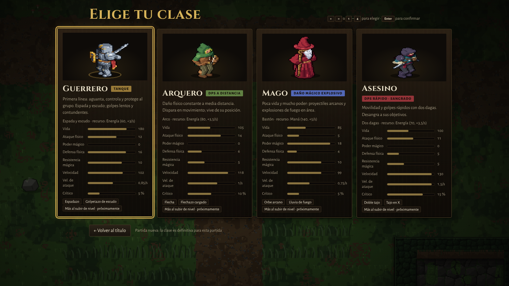
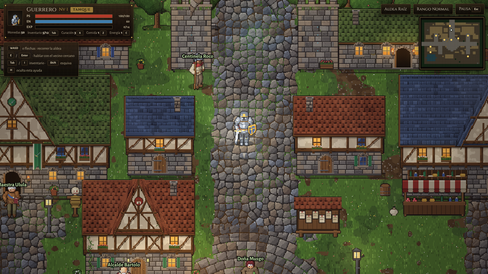
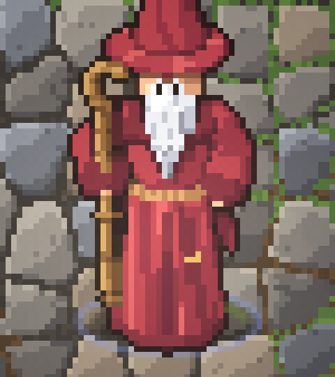
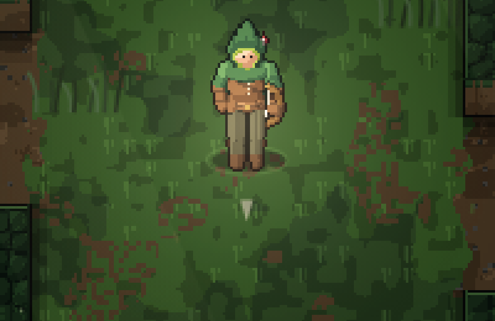
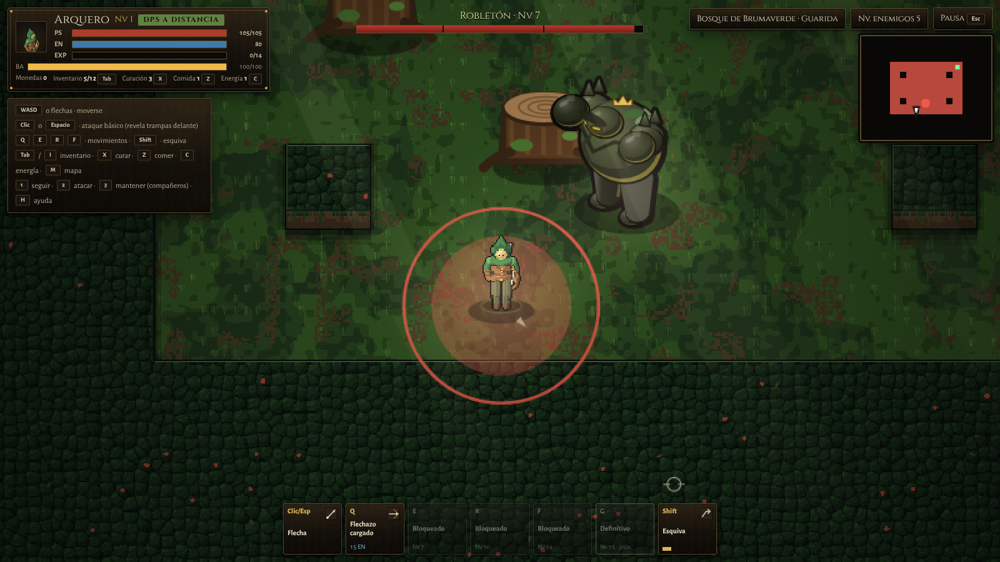

# Auditoría visual de Eldoria (10-11-2026)

- **Para qué:** recopilar el aspecto **real y actual** del juego para que ChatGPT lo evalúe y proponga mejoras artísticas.
- **Qué no se ha hecho:** no se ha rediseñado ni modificado nada. Ni código, ni gráficos, ni mapas, ni personajes, ni interfaz, ni animaciones.
- **Estado:** solo documentación. Rama `tarea/auditoria-visual`, sin fusionar.

## Cómo se han hecho las capturas

| | |
|---|---|
| **Versión** | `main` **0.46** (commit `5d28bcf`) para todo el mundo del juego: aldea, clases, exteriores, mazmorras, combates y jefes. Las ramas abiertas no cambian el arte |
| **Interfaz** | Dos versiones: la publicada (`main`) y el rediseño **pendiente de fusión** de `tarea/interfaz-mmo` (`00d6d8f`). El indicador de apuntado del Arquero sale de `tarea/arquero-apuntado` (`94afb02`), también pendiente de fusión. Cada archivo lo indica en su nombre |
| **Ejecución** | El juego real (`prototype/mystery-action.html`, el mismo código de dibujo que usa el cliente en línea) en Chromium, controlado con Playwright |
| **Resolución** | 1600 × 900, escala de píxel 1 (resolución nativa de la ventana). Sin recortes en las capturas completas |
| **Ampliaciones** | Recortes de esas mismas capturas, escalados ×2, ×3 o ×4 por **vecino más próximo**: cada píxel se repite, sin suavizado ni filtros. Llevan `_x2`, `_x3` o `_x4` en el nombre |
| **Sin retoques** | PNG sin pérdida. Solo se recomprimió el archivo sin cambiar ningún píxel (comprobado imagen a imagen) |
| **Cómo se llegó a cada escena** | Con las funciones del propio juego: partida nueva de cada clase, entrar en una mazmorra o zona, ir al piso del jefe, abrir el inventario, y combates reales en los que el jugador ataca con el ratón del juego. El guion está en [`capturas/auditoria-visual/capturas.py`](capturas/auditoria-visual/capturas.py), para repetirlo |
| **Tipografía** | Las fuentes del juego (Cinzel y Alegreya Sans) se cargan de Google Fonts, que este entorno no alcanza. Para que las capturas muestren la tipografía real, se instalaron en el sistema **los mismos archivos** de esas fuentes (repositorio oficial `google/fonts`, licencia OFL). El juego no se tocó |
| **Limitaciones** | Chromium sin GPU (dibujo por software: el mismo resultado de píxeles, menos rendimiento). Es el prototipo sin conexión, no la sala de un grupo en línea; el dibujo del mundo es el mismo, pero no hay compañeros en pantalla. No hay capturas de móvil |

## Capturas

Carpeta: [`docs/capturas/auditoria-visual/`](capturas/auditoria-visual/), 39 imágenes, unos 13 MB.

### 0. Pantallas de inicio

| Archivo | Qué muestra |
|---|---|
| `00_titulo.png` | Título del prototipo: «Mystery Action» sobre un fondo de mazmorra desenfocado y oscuro |
| `00_seleccion_clase.png` | Selección de clase: cuatro tarjetas con retrato animado, etiqueta de rol, estadísticas en barras y habilidades |

### 1. La aldea

| Archivo | Qué muestra |
|---|---|
| `01_aldea_general.png` | Llegada a la aldea (Guerrero en la calle principal), vecinos con su nombre, HUD de la aldea, minimapa y ayuda de teclas |
| `01_aldea_centro.png` | Otra zona tras caminar unos segundos |

### 2. El personaje en el mapa

| Archivo | Qué muestra |
|---|---|
| `02_personaje_y_entorno_x2.png` | Guerrero con su entorno inmediato (adoquines, casas), ×2 |

### 3. Las cuatro clases

| Archivo | Qué muestra |
|---|---|
| `03_guerrero_aldea.png`, `03_guerrero_sprite_x4.png` | Guerrero: caballero con yelmo cerrado, capa roja, escudo azul con cruz dorada, espada |
| `03_arquero_aldea.png`, `03_arquero_sprite_x4.png` | Arquero: capucha verde, jubón de cuero, arco |
| `03_mago_aldea.png`, `03_mago_sprite_x4.png` | Mago: sombrero de punta, túnica granate, barba blanca, bastón |
| `03_asesino_aldea.png`, `03_asesino_sprite_x4.png` | Asesino: capucha oscura, máscara granate, dos dagas |

### 4. Exterior: bosque

| Archivo | Qué muestra |
|---|---|
| `04_linde_brumaverde.png` | Linde de Brumaverde, la zona «exterior» del capítulo 1, al entrar |
| `04_bosque_piso1.png`, `04_bosque_tiles_x3.png` | Bosque de Brumaverde, piso 1, y ampliación del suelo, los muros de follaje y el Arquero |

### 5. Mazmorras

| Archivo | Qué muestra |
|---|---|
| `05_mazmorra_gruta.png`, `05_gruta_tiles_x3.png` | Gruta de Cuarzo, piso 1, y ampliación del suelo de losas y las vetas de cristal |
| `05_mazmorra_mina.png` | Mina Olvidada, piso 1 |
| `05_mazmorra_crater.png` | Cráter, piso 1 |

### 6. Combate contra enemigos normales

| Archivo | Qué muestra |
|---|---|
| `06_combate_normal.png`, `06_combate_normal_b.png` | Combate real en el Bosque (Guerrero contra criaturas del bosque): número de daño, anillo de golpe, etiquetas de nivel y barras de vida de los enemigos |
| `06_combate_normal_x3.png` | Ampliación del Guerrero atacando y de un enemigo |

### 7. Jefes

| Archivo | Qué muestra |
|---|---|
| `07_jefe_robleton_sala.png`, `07_jefe_robleton_combate.png`, `07_jefe_robleton_sprite_x3.png` | Robletón en su guarida: tocones, raíces avisadas (círculos naranjas), impacto y número de daño, barra del jefe con sus fases |
| `07_jefe_gromgar_sala.png`, `07_jefe_gromgar_combate.png`, `07_jefe_gromgar_sprite_x3.png` | Gromgar en la Mina: sala, ataque avisado y ampliación del sprite |

### 8. Inventario y equipo

| Archivo | Qué muestra |
|---|---|
| `08_inventario_main.png` | Inventario publicado (0.46): cuadrícula con pestañas y ranuras de equipo **solo con texto** |
| `08_inventario_interfaz-mmo.png` | Rediseño pendiente de fusión: dos paneles, sprite del personaje con 6 ranuras con silueta, estadísticas con vista previa |

### 9. HUD y barra de habilidades

| Archivo | Qué muestra |
|---|---|
| `09_hud_main.png`, `09_hud_panel_main_x2.png`, `09_hud_barras_main_x2.png` | HUD publicado: panel del personaje, atajos de consumibles en texto y barra de habilidades |
| `09_hud_interfaz-mmo.png`, `09_hud_panel_interfaz-mmo_x2.png`, `09_hud_barras_interfaz-mmo_x2.png` | HUD del rediseño: barra de consumibles con iconos (X, Z, C) encima de las habilidades |
| `09_arquero_asistencia_tarea-arquero-apuntado.png`, `09_arquero_asistencia_x3.png` | Indicador de la asistencia de apuntado: marcas doradas a los pies del enemigo |

## Recursos gráficos: de dónde sale cada cosa

**No hay hojas de sprites, tilesets ni imágenes en el repositorio.** Todo el arte del juego se **genera por código** al cargar, dentro de `prototype/mystery-action.html`. Ese archivo es la fuente de verdad, y el cliente se genera a partir de él con `tools/split-prototype.mjs`.

Los únicos archivos de imagen versionados son:

- `installer/icon.png` (icono del instalador);
- las capturas de esta auditoría.

**Fuentes:** Cinzel (títulos) y Alegreya Sans (textos), de Google Fonts.

Ubicación en `prototype/mystery-action.html` de `main` 0.46 (los números de línea pueden variar):

| Qué | Módulo | Línea | Técnica |
|---|---|---|---|
| Héroes (4 clases, 8 direcciones, animaciones) | `HeroSprites`, sobre `PixelArt` | 13019, 12228 | **Pixel art** generado: maniquí de volúmenes pintado píxel a píxel con 6 tonos por material, contorno y sin suavizado. Lienzo de 124 × 108. Detalle en `docs/SPRITES.md` |
| Vecinos de la aldea | `VillagerArt` | 13069 | Pixel art generado (mismo sistema) |
| Enemigos «pixel» (familias rata, lagarto, limo, ave, hongo y planta: **32 variantes**) | `EnemySprites`, sobre `PixelArt` | 3120 | Pixel art generado. Cada variante es su familia con **otra paleta** |
| Enemigos «vectoriales» (familias mordisquín, pufón y pedrolón y sus variantes: **15**) | `kind.draw` de cada familia, con `drawCreature` y `Art` | 1640, 11654 | **Formas vectoriales** de canvas (trazos y rellenos con suavizado), no pixel art |
| Jefes (Robletón, Gromgar, Reina Geoda) | `BOSSES` / `makeBossKind`, `kind.draw`; estados en `BossArt` | 3250, 3264, 3823 | **Vectoriales**, dibujados a escala 2 (`drawScale: 2`) |
| Suelo de la aldea | `TownGround` | 8340 | Pintado píxel a píxel por trozos de 8 × 8 casillas: adoquines con Voronoi, plaza, hierba y estanque |
| Casas y elementos de la aldea | `TownArt`, `TownScene`, `VillageArt`, paleta `TP` | 8461, 9011, 7955, 8276 | Pixel art generado (13 casas con planta propia, tejados, entramado, faroles, puestos). Detalle en `docs/MUNDO.md` |
| Suelo y muros de las mazmorras | `DungeonGround`, `TileArt`, `DungeonScenery` | 9142, 913, 9289 | Generado por casilla con **una paleta por bioma** (`terrain`: forest, cave, volcano, marsh, mine, en las definiciones de cada mazmorra, hacia la línea 4274) |
| Decoración | `Deco` | 1389 | Hierba, setas, piedras y charcos sobre las casillas |
| Cofres y mecanismos | `ChestArt`, `MechArt` | 9308, 9429 | Generados (palancas, placas, raíces, estelas, etc.) |
| Iluminación y atmósfera | `Light` (y viñeta y partículas por bioma) | 9835 | Luces radiales sobre un búfer a media resolución; rayos, polvo, hojas y ascuas |
| Efectos de combate | `Effects`, `Particles`, `Projectile` | 1829, 1548, 1950 | Números de daño, impactos, anillos y proyectiles |
| Iconos de objetos | `itemSprite` y `drawItemIconStyled`, `UI.icon` | 4711–4716, 10509 | Dibujados por código a 24 px y mostrados a 34–44 px |
| Iconos de habilidades | lienzo por movimiento | 10135 | Dibujados por código |
| Interfaz (HUD, ventanas, botones) | CSS en `<style>` (principio del archivo) y HTML | 1–420 | HTML y CSS con paleta de tokens: paneles oscuros, dorado, marcos finos |
| Render | `Renderer` | 9917 | Búfer de «píxel de arte» de tamaño entero y luego escalado a pantalla, sin suavizado |

### Clasificación

| Tipo | Qué entra |
|---|---|
| **Sprites propios** (diseño original y específico) | Los 4 héroes; los vecinos; las 13 casas y la aldea; los 3 jefes; las 9 familias de enemigos |
| **Reutilizado** | 47 variantes de enemigos que son 9 familias recoloreadas; los suelos y muros de las mazmorras, con el mismo generador y otra paleta por bioma (el Linde usa la del Bosque); las salas y pasillos, con el mismo generador en todas las zonas, incluida la «exterior» del Linde |
| **Provisional o incompleto** | En la barra de habilidades, los huecos «Bloqueado» (niveles 7, 10 y 14) y «Definitivo · próx.» (nivel 15), sin contenido; el título «Mystery Action» y su texto («Forma tu equipo de rescate…»), que no corresponden a la identidad actual de Eldoria; el inventario publicado, con ranuras de equipo solo de texto (el rediseño está pendiente de fusión) |

## Problemas visuales identificados

Son observaciones sobre las capturas, no evaluaciones finales: la evaluación independiente corresponde a ChatGPT.

1. **Mezcla de estilos.** Los héroes, los vecinos, la aldea y 32 variantes de enemigos son **pixel art de píxel duro**. Los **jefes** y 15 variantes de enemigos son **vectoriales**, con bordes suavizados y degradados. Se ve claramente en `07_jefe_robleton_sprite_x3.png` y `07_jefe_gromgar_sprite_x3.png` frente a `03_*_sprite_x4.png`.
2. **Iconos de objetos y habilidades** con aspecto más vectorial y «limpio» que el mundo en pixel art (`08_*`, `09_hud_barras_*`).
3. **Exterior que parece interior.** El Linde de Brumaverde, presentado como zona exterior, usa salas rectangulares y pasillos rodeados de muros de follaje (`04_linde_brumaverde.png`). No se lee como un bosque abierto.
4. **Muros de follaje repetitivos y oscuros.** Grandes masas con una textura uniforme y motas rojas (`04_bosque_*`). Ocupan buena parte de la pantalla.
5. **Suelos con ruido sin estructura.** El suelo de bosque y de cueva está hecho de motas y manchas pequeñas (`04_bosque_tiles_x3.png`, `05_gruta_tiles_x3.png`). Comparado con los adoquines de la aldea, tiene poco diseño.
6. **Mazmorras muy oscuras.** Mina y Cráter con poca luz (`05_mazmorra_mina.png`, `05_mazmorra_crater.png`): fuera del círculo del jugador apenas se distingue nada.
7. **Diferencia de calidad entre la aldea y las mazmorras.** La aldea tiene casas detalladas, tejados, luz cálida y vecinos. Las mazmorras tienen menos elementos y menos variedad.
8. **HUD cargado al empezar:**
   - el panel de ayuda de teclas está visible por defecto y tapa la parte izquierda de la escena;
   - la barra de habilidades muestra 4 huecos sin contenido;
   - el minimapa está casi vacío al entrar en un piso.
9. **Textos superpuestos en el centro de la pantalla.** Indicaciones como «Golpea la palanca» y el cartel de piso.
10. **Escala de las criaturas pequeñas.** Algunas, como las setas del bosque, son muy pequeñas frente a los héroes (unos 54 px de alto) y se distinguen poco del suelo.
11. **Título y marca.** La pantalla de título dice «Mystery Action», con un texto de presentación que no encaja con Eldoria.

## Limitaciones técnicas para mejorar el arte

- **Todo el arte es código dentro de un solo archivo de unas 14.000 líneas.**
  - No hay canal de recursos: ni cargador de imágenes, ni hojas de sprites, ni atlas.
  - Usar sprites o tiles dibujados a mano exige crear ese canal (cargar las imágenes, recortar fotogramas y animar).
  - Encaja con la arquitectura: el dibujo es solo del cliente, y el servidor y las reglas no dependen de él (`docs/MUNDO.md`, «Separación entre dibujo y reglas»).
- **Escala del píxel de arte.** El mundo se pinta con 1 píxel de arte = 1 unidad del mundo, y la cámara ajusta el zoom a la altura de la ventana.
  - El búfer usa un factor entero, pero el paso del mundo al búfer no es entero en la mayoría de resoluciones. Por ejemplo, a 1600 × 900 el zoom es 2,16 (factor 2 × 1,08).
  - Algunos píxeles de arte pueden ocupar un píxel de búfer más que otros. Es poco visible, pero condiciona el pixel art fino.
- **Los dos sistemas de dibujo de criaturas** (pixel art y vectorial) conviven. Unificar el estilo de jefes y enemigos implica redibujar esas familias en el sistema de pixel art o con sprites nuevos.
- **Las colisiones son círculos en el suelo**, independientes del dibujo (`docs/MUNDO.md`). Un sprite más grande no cambia el juego, pero conviene mantener la proporción para que se lea bien (ver `docs/ARQUERO_APUNTADO.md`).
- **Rendimiento.** Las mazmorras generan sus suelos por trozos y las luces se calculan a media resolución. `docs/MUNDO.md` mide unos 60 fps en Chromium sin GPU. Más capas o más luces deben medirse.
- **Dependencia externa de las fuentes (Google Fonts).** Sin conexión a esos servidores, el juego cae a fuentes del sistema.
- **Sin artista ni herramientas en el flujo.** Hoy cualquier cambio visual se hace programando. Un cambio de dirección artística grande necesita decidir si se sigue con arte generado por código o se pasa a arte dibujado (propio o con licencia compatible, nunca de franquicias protegidas, D-007).

## Pendiente

- **Evaluación de ChatGPT:** independiente, con propuestas concretas, que se transcribirá en `docs/coordinacion/REVISIONES_CHATGPT.md`.
- **Capturas adicionales, si se piden:**
  - móvil o resoluciones pequeñas;
  - partida en grupo con varios héroes en pantalla;
  - la Ciénaga y las Raíces Hondas;
  - la Reina Geoda;
  - cada familia de enemigos por separado.
